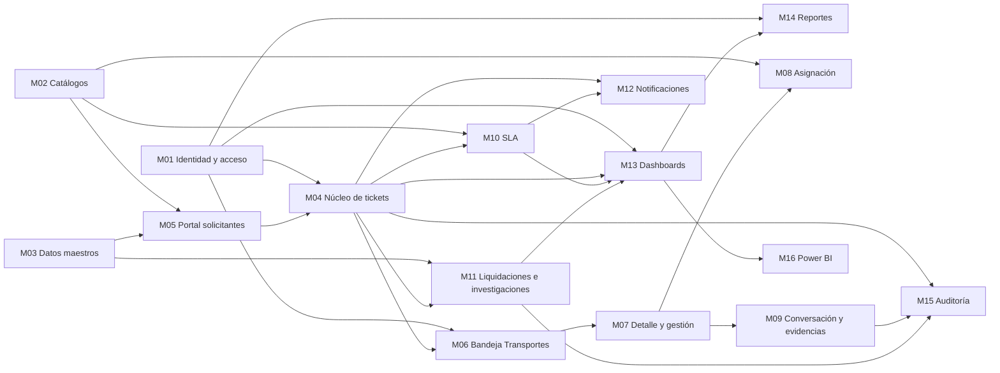
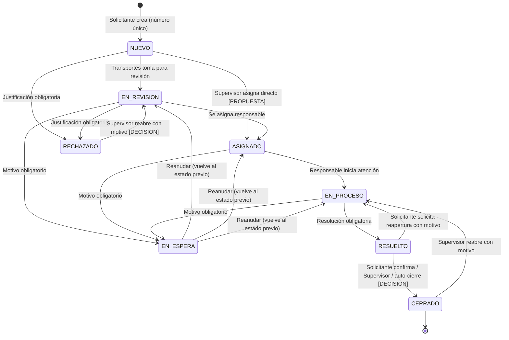
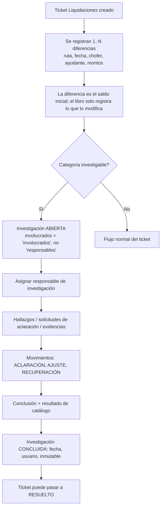
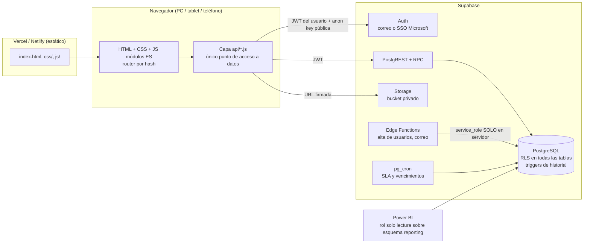

# ArreoPrime Desk | TRANSPORTES SERVICE DESK
## FASE 1 — Análisis funcional y arquitectura

| Campo | Valor |
|---|---|
| Versión | 0.1 (borrador para aprobación) |
| Fecha | 2026-11-16 |
| Estado | Pendiente de aprobación |
| Siguiente fase | FASE 2 — Prototipo UX/UI (solo tras aprobación) |

> Este documento no contiene código de producción. Su objetivo es fijar alcance, reglas de negocio, arquitectura y decisiones pendientes antes de construir. Las secciones marcadas **[PROPUESTA]** son recomendaciones que requieren su visto bueno; las marcadas **[DECISIÓN]** necesitan una respuesta suya (ver sección 9).

---

## 1. Resumen ejecutivo

- **Qué es:** una mesa de servicio con un único receptor (Transportes) y tres departamentos solicitantes (Comercial, Almacén, Liquidaciones), con visibilidad **por departamento**.
- **Arquitectura recomendada:** frontend estático en HTML/CSS/JavaScript puro (módulos ES, sin npm ni build) + **Supabase** (PostgreSQL, Auth, RLS, Storage, Edge Functions, pg_cron). Despliegue del frontend en Vercel o Netlify.
- **Principio de seguridad central:** el navegador **nunca** modifica tablas directamente. Toda escritura de negocio pasa por **funciones RPC en PostgreSQL** que validan rol, departamento, estado y transición; la lectura está filtrada por **RLS**. Ocultar botones en JavaScript es solo comodidad visual.
- **Principio financiero central:** los montos viven en un **libro de movimientos inmutable** (un registro por movimiento, con su propio ID). Los indicadores se calculan desde ese libro, nunca desde el ticket ni desde comentarios.
- **Bloqueantes antes de producción:** tiempos SLA, horario laboral y feriados (no se inventarán), fórmula oficial de la diferencia de liquidación, canal de notificaciones y método de autenticación. Ninguno bloquea el prototipo (Fase 2).

---

## 2. Módulos del sistema

| # | Módulo | Responsabilidad | Usuarios principales |
|---|---|---|---|
| M01 | Identidad y acceso | Autenticación, perfiles, roles, departamentos, matriz de permisos centralizada, sesiones | Todos / Administrador |
| M02 | Catálogos y configuración | Tipos de gestión, categorías, campos dinámicos por categoría, prioridades, motivos de espera/rechazo, respuestas rápidas | Administrador |
| M03 | Datos maestros | Clientes, rutas, vehículos, colaboradores (choferes/ayudantes), bodegas, unidades de medida | Administrador |
| M04 | Núcleo de tickets | Numeración, creación, máquina de estados, prioridad, anulación documentada | Todos |
| M05 | Portal de solicitantes | Crear solicitud (3 pasos), solicitudes del departamento, consultar estado | Solicitantes |
| M06 | Bandeja central de Transportes | Tabla, filtros rápidos y avanzados, búsqueda, orden, paginación, columnas personalizables | Operador / Supervisor / Gerencia (lectura) |
| M07 | Detalle y gestión del ticket | Panel de 4 secciones: Información, Gestión, Conversación, Historial | Todos según rol |
| M08 | Asignación y carga de trabajo | Asignación manual, reasignación, responsable sugerido, asignación automática opcional, control de carga | Supervisor |
| M09 | Conversación y evidencias | Comentarios públicos, notas internas, solicitudes de información, respuestas, archivos privados | Todos según rol |
| M10 | SLA | Políticas versionadas por categoría y prioridad, calendario laboral, feriados, pausas, excepciones, semáforo | Administrador / Supervisor |
| M11 | Liquidaciones e investigaciones | Diferencias financieras, libro de movimientos, investigaciones, hallazgos, conclusiones, recuperaciones | Liquidaciones / Transportes autorizado / Gerencia |
| M12 | Notificaciones | Eventos, bandeja in-app, correo (si se aprueba), preferencias por usuario | Todos |
| M13 | Dashboards e indicadores | Operativo, gerencial, financiero; filtros por período y departamento respetando permisos | Operador / Supervisor / Gerencia |
| M14 | Reportes y exportaciones | Reportes predefinidos, exportación CSV / Excel / PDF bajo las mismas reglas de visibilidad | Supervisor / Gerencia |
| M15 | Auditoría e historial | Historial por ticket (inmutable) y auditoría de operaciones sensibles y de administración | Supervisor / Administrador |
| M16 | Integración Power BI | Esquema `reporting` con vistas de grano definido y rol de base de datos de solo lectura | Gerencia / BI |

### 2.1 Relaciones entre módulos



**Dependencias críticas:**
- **M01 es transversal:** toda lectura (bandejas, búsquedas, dashboards, reportes, exportaciones, archivos, API) se filtra con las mismas funciones de autorización en base de datos. No existen “consultas especiales” que salten la RLS desde el navegador.
- **M04 → M15:** cada cambio en un ticket genera su evento de historial mediante triggers, no mediante código del navegador; así el historial no puede omitirse ni falsificarse.
- **M11 es un submódulo con su propia seguridad:** el ticket de Liquidaciones es visible para Transportes, pero los montos están en tablas separadas con permisos más estrictos (ver 4.3).

---

## 3. Flujo completo del ticket

### 3.1 Diagrama de estados



Además: **cierre excepcional** del Supervisor desde cualquier estado no terminal hacia CERRADO, con justificación obligatoria y marca `cierre_excepcional = true` (se reporta por separado para no distorsionar el cumplimiento SLA).

### 3.2 Tabla de transiciones (fuente única de verdad)

Las transiciones se guardan en la tabla `transiciones_estado` y se validan en la función RPC `fn_ticket_cambiar_estado`. Cualquier transición no listada es rechazada por la base de datos.

| De | A | Quién puede | Requisito obligatorio | Efecto en SLA |
|---|---|---|---|---|
| (alta) | NUEVO | Solicitante del departamento | Campos obligatorios de la categoría | Inicia reloj de primera respuesta, asignación y resolución |
| NUEVO | EN_REVISION | Supervisor; Operador si tiene permiso de triaje [DECISIÓN] | — | Marca primera respuesta [DECISIÓN definición] |
| NUEVO / EN_REVISION | ASIGNADO | Supervisor; Operador solo para autoasignarse si se permite [DECISIÓN] | Responsable activo, con alcance sobre la categoría | Detiene reloj de asignación |
| NUEVO / EN_REVISION | RECHAZADO | Supervisor (¿Operador?) [DECISIÓN] | Motivo de catálogo + justificación libre | Detiene relojes |
| EN_REVISION / ASIGNADO / EN_PROCESO | EN_ESPERA | Responsable o Supervisor | Motivo de catálogo; si es “información del solicitante” se crea una solicitud de información | Pausa según el motivo [DECISIÓN] |
| EN_ESPERA | estado previo | Responsable, Supervisor o automático al responder el solicitante [DECISIÓN] | — | Reanuda reloj |
| ASIGNADO | EN_PROCESO | Responsable asignado | — | — |
| EN_PROCESO | RESUELTO | Responsable o Supervisor | Texto de resolución; en Liquidaciones, investigación concluida | Detiene reloj de resolución |
| RESUELTO | CERRADO | Solicitante (confirma), Supervisor, o auto-cierre tras N días hábiles [DECISIÓN] | — | — |
| RESUELTO | EN_PROCESO | Solicitante del departamento | Motivo de reapertura; dentro de ventana de N días [DECISIÓN] | Reanuda reloj de resolución (contador de reaperturas +1) |
| CERRADO | EN_PROCESO | Supervisor | Motivo | Reanuda reloj de resolución |
| Cualquiera no terminal | CERRADO | Supervisor | Justificación (cierre excepcional) | Excluido/registrado aparte |

**Reglas complementarias:**
- **Reasignación:** cambia el responsable sin perder historial. [PROPUESTA] Si ocurre en EN_PROCESO, el ticket vuelve a ASIGNADO para que el nuevo responsable confirme el inicio.
- **Prioridad:** al crear, el sistema propone una prioridad según la matriz configurable *(tipo de gestión × categoría)*; el Supervisor puede cambiarla con motivo. Se guardan ambas: `prioridad_sugerida` y `prioridad` vigente, y el cambio queda en historial.
- **Aprobaciones:** no se implementan por defecto. La categoría tiene un indicador `requiere_aprobacion` (inactivo en todas) hasta que usted defina cuáles lo requieren y quién aprueba.
- **Sin borrado físico:** un ticket creado por error se **anula** (Supervisor, con motivo); queda visible en historial y excluido de indicadores.

### 3.3 Recorrido funcional de punta a punta

1. **Creación (Solicitante, < 60 s):** Paso 1 elige categoría (el tipo de gestión se precarga desde la categoría y puede ajustarse) → Paso 2 llena solo los campos de esa categoría y adjunta evidencias → Paso 3 revisa y envía. El departamento **lo asigna la base de datos** desde el perfil del usuario, no el formulario.
2. **Confirmación:** se muestra número (p. ej. `TS-2026-000123`), fecha, departamento, categoría, prioridad sugerida, estado NUEVO.
3. **Recepción:** aparece en la bandeja central; notificación a Supervisor (y operadores según preferencias).
4. **Revisión / triaje:** se valida que la información esté completa; si falta algo → EN_ESPERA con solicitud de información al solicitante.
5. **Asignación:** manual o sugerida (responsable por categoría / menor carga). Nunca a usuarios inactivos o sin alcance.
6. **Atención:** EN_PROCESO; comentarios públicos, notas internas, evidencias, avances.
7. **Resolución:** RESUELTO con texto obligatorio; notificación al solicitante.
8. **Cierre:** el solicitante confirma (o reabre con motivo); el Supervisor puede cerrar o reabrir; todo queda en historial con usuario, fecha y hora.

### 3.4 Flujo especial: Liquidaciones



- **Presunción de no responsabilidad:** el sistema no tiene un campo “responsable del faltante”. Los colaboradores se registran como **involucrados** (chofer, ayudante, otro). La atribución solo existe como **resultado** de la conclusión documentada.
- **Resultados posibles (catálogo cerrado):** Diferencia justificada · Pendiente de aclaración · Error documental · Error operativo · Atribuible a otro proceso · No determinada · Escalado.
- **Una investigación concluida no se edita.** Si aparece información nueva, el Supervisor la **reabre** con motivo y la conclusión anterior se conserva en historial.

---

## 4. Matriz de roles y permisos

### 4.1 Modelo

- **Rol** (SOLICITANTE, OPERADOR_TRANSPORTES, SUPERVISOR_TRANSPORTES, GERENCIA, ADMINISTRADOR) + **Departamento** (COMERCIAL, ALMACEN, LIQUIDACIONES, TRANSPORTES, y [PROPUESTA] GERENCIA / SISTEMAS para perfiles no operativos).
- Los permisos son **códigos** en la tabla `permisos`, asignados a roles en `rol_permisos`. Permisos individuales adicionales (p. ej. ver información financiera para un operador concreto) se otorgan en `perfil_permisos`, siempre auditados.
- Una función única en base de datos, `fn_tiene_permiso(codigo)`, es usada por **todas** las políticas RLS y funciones RPC. El frontend lee la misma matriz solo para mostrar u ocultar opciones.
- **[PROPUESTA]** Un rol por usuario. Si una persona necesita dos roles (p. ej. Supervisor y Administrador) se recomiendan dos cuentas, para no mezclar administración con operación.

### 4.2 Matriz

Leyenda: ✅ permitido · 🔸 condicionado (ver nota) · — no permitido · SOL = solicitante (aplica solo a **su** departamento)

| Permiso | SOL Comercial | SOL Almacén | SOL Liquidaciones | Operador | Supervisor | Gerencia | Admin |
|---|---|---|---|---|---|---|---|
| Crear ticket (solo de su departamento) | ✅ | ✅ | ✅ | 🔸 registro asistido [DECISIÓN] | 🔸 registro asistido | — | — |
| Ver tickets de su departamento | ✅ | ✅ | ✅ | — | — | — | — |
| Ver todos los tickets | — | — | — | ✅ | ✅ | ✅ lectura | — |
| Comentario público | ✅ | ✅ | ✅ | ✅ | ✅ | — | — |
| Responder solicitud de información | ✅ | ✅ | ✅ | — | — | — | — |
| Ver notas internas | — | — | — | ✅ | ✅ | 🔸 [DECISIÓN] | — |
| Crear nota interna | — | — | — | ✅ | ✅ | — | — |
| Subir evidencias | ✅ | ✅ | ✅ | ✅ | ✅ | — | — |
| Ver evidencias | 🔸 públicas de su depto. | 🔸 | 🔸 | ✅ | ✅ | ✅ | — |
| Tomar en revisión (triaje) | — | — | — | 🔸 [DECISIÓN] | ✅ | — | — |
| Asignar / reasignar | — | — | — | 🔸 autoasignarse [DECISIÓN] | ✅ | — | — |
| Cambiar prioridad | — | — | — | — | ✅ | — | — |
| Cambiar estado operativo | — | — | — | 🔸 solo tickets asignados/autorizados | ✅ | — | — |
| Resolver | — | — | — | 🔸 asignados | ✅ | — | — |
| Rechazar (con justificación) | — | — | — | 🔸 [DECISIÓN] | ✅ | — | — |
| Confirmar resolución | ✅ | ✅ | ✅ | — | — | — | — |
| Solicitar reapertura | ✅ | ✅ | ✅ | — | — | — | — |
| Cerrar / cierre excepcional / reabrir | — | — | — | — | ✅ | — | — |
| Anular ticket (documentado) | — | — | — | — | ✅ | — | — |
| Ver información financiera | — | — | ✅ su depto. | 🔸 con permiso `financiero.ver` | ✅ | 🔸 [DECISIÓN] | — |
| Registrar movimientos financieros | — | — | — | 🔸 con permiso | ✅ | — | — |
| Ver investigaciones | — | — | 🔸 [DECISIÓN] | 🔸 con permiso | ✅ | ✅ lectura | — |
| Gestionar / concluir investigación | — | — | — | 🔸 responsable asignado | ✅ | — | — |
| Dashboard operativo | — | — | — | ✅ | ✅ | ✅ | — |
| Dashboard gerencial / financiero | — | — | 🔸 financiero de su depto. | — | ✅ | ✅ | — |
| Reportes y exportaciones | 🔸 de su depto. [DECISIÓN] | 🔸 | 🔸 | 🔸 | ✅ | ✅ | — |
| Consultar auditoría | — | — | — | — | ✅ operativa | — | ✅ administrativa |
| Usuarios, roles, permisos, departamentos | — | — | — | — | — | — | ✅ (excepto su propio rol) |
| Catálogos, categorías, SLA, calendario | — | — | — | — | 🔸 consulta | — | ✅ |

**Reglas duras (validadas en base de datos, no en JavaScript):**
1. `departamento_id` y `solicitante_id` del ticket los fija la RPC desde el perfil autenticado; los valores enviados por el navegador se ignoran.
2. La tabla `perfiles` no tiene política UPDATE para el propio usuario sobre `rol`, `departamento_id` ni `activo`; solo el Administrador vía RPC, y **nunca sobre sí mismo**.
3. Gerencia no tiene ninguna política INSERT/UPDATE/DELETE.
4. El Administrador **no** tiene lectura de tickets, comentarios ni montos por defecto; su función es configurar.
5. `historial_tickets` y `auditoria` no admiten UPDATE ni DELETE para ningún rol de la aplicación (sin políticas + `REVOKE` + trigger que lanza error).

### 4.3 Cómo se garantiza la privacidad de notas internas y montos

| Dato | Dónde vive | Control |
|---|---|---|
| Comentario público vs nota interna | Tabla `comentarios`, columna `visibilidad` (PUBLICO / INTERNO) | Política RLS: los solicitantes solo leen filas `PUBLICO` de su departamento. Las evidencias adjuntas a una nota interna heredan `INTERNO`. Los eventos de historial generados por notas internas también se marcan `INTERNO`. |
| Montos de Liquidaciones | Tablas `liquidacion_diferencias`, `movimientos_financieros`, `recuperaciones` (nunca en el JSON del ticket) | RLS propia con `fn_tiene_permiso('financiero.ver')`; un operador sin ese permiso ve el ticket pero no los montos. |
| Archivos | Bucket **privado** `evidencias`, ruta `{ticket_id}/{evidencia_id}` | Políticas de Storage que consultan la tabla `evidencias` + URLs firmadas de corta duración (p. ej. 5 minutos). |
| Exportaciones y dashboards | Vistas con `security_invoker = on` | La vista se ejecuta con los permisos de quien consulta: imposible exportar lo que no se puede ver. |

---

## 5. Arquitectura tecnológica recomendada

### 5.1 Decisión: Supabase vs API corporativa

| Criterio | Supabase | API corporativa propia |
|---|---|---|
| Autenticación, sesiones, recuperación de contraseña, SSO Microsoft | Incluido | Por construir |
| RLS a nivel de base de datos | Nativo (PostgreSQL) | Depende de la implementación |
| Almacenamiento de archivos con políticas | Incluido | Por construir |
| Encaja con “HTML/CSS/JS puro, sin Node/npm” | Sí (cliente JS por CDN o archivo local) | Requiere un servidor (normalmente Node, .NET o similar) |
| Despliegue del frontend en Vercel/Netlify | Sí, sitio estático | Sí, pero la API vive aparte |
| Mantenimiento | Bajo | Alto |
| Portabilidad | Alta: es PostgreSQL estándar; los scripts SQL son reutilizables | Total |

**Recomendación: Supabase**, plan de pago (Pro) para producción por respaldos diarios, recuperación puntual opcional (PITR) y para evitar la pausa por inactividad del plan gratuito. El plan gratuito sirve para desarrollo y pruebas.

### 5.2 Diagrama



### 5.3 Reglas de arquitectura

1. **Escrituras solo por RPC.** Las tablas de negocio no tienen políticas INSERT/UPDATE directas para usuarios; las funciones `fn_ticket_crear`, `fn_ticket_cambiar_estado`, `fn_ticket_asignar`, `fn_ticket_comentar`, `fn_diferencia_registrar_movimiento`, `fn_investigacion_concluir`, etc. validan todo y escriben historial en la misma transacción. Las funciones `SECURITY DEFINER` fijan `search_path` y verifican `auth.uid()` explícitamente.
2. **La `anon key` es pública por diseño**; la seguridad depende de RLS. La `service_role` vive únicamente en variables de entorno de Edge Functions.
3. **Alta de usuarios sin autorregistro:** el registro público se desactiva. El Administrador crea/invita usuarios mediante una Edge Function que verifica su rol.
4. **Zona horaria:** todo se guarda como `timestamptz` (UTC) y se presenta en `America/Costa_Rica` (UTC−6, sin horario de verano).
5. **Moneda:** `numeric(14,2)` en CRC; nunca `float`.
6. **SLA en el servidor:** el cálculo en horas hábiles lo hace PostgreSQL (calendario + feriados + pausas). pg_cron ejecuta cada pocos minutos la detección de “próximo a vencer” y “vencido” y genera notificaciones.
7. **localStorage** solo para preferencias de interfaz (columnas visibles, tema, último filtro).

### 5.4 Frontend: dependencias mínimas y justificadas

| Necesidad | Solución | Justificación |
|---|---|---|
| Cliente Supabase (sesión, refresco de token, Storage) | `supabase-js` versión fija, copiada en `js/vendor/` | Reimplementar el manejo de sesiones con `fetch` es posible pero más riesgoso; es la única dependencia funcional. |
| Gráficos | SVG propio para KPI simples; [PROPUESTA] Chart.js versión fija solo si los gráficos de tendencia lo justifican | Evitar dependencias pesadas. |
| PDF | Hojas de estilo de impresión + `window.print()` | Sin dependencia. |
| CSV | Generación nativa en JS | Sin dependencia. |
| Excel (.xlsx) | [DECISIÓN] librería SheetJS fija en `vendor/`, o generar el .xlsx en una Edge Function | Excel nativo requiere una librería en algún lado. CSV abre en Excel si se acepta como alternativa. |

### 5.5 Estructura de carpetas propuesta

```
/index.html                  punto de entrada único
/css/tokens.css              colores, tipografía, espaciado (tema claro/oscuro)
/css/base.css  layout.css  components.css
/js/app.js                   arranque, sesión, router por hash (#/bandeja, #/ticket/123)
/js/config.js                URL de Supabase y anon key (públicas por diseño)
/js/core/                    router, estado, permisos (solo UI), formatos (CRC, fechas CR)
/js/ui/                      componentes: tabla, modal, toast, formulario dinámico, semáforo SLA
/js/api/                     acceso a datos (único lugar que habla con Supabase)
/js/api/mock/                datos de DEMOSTRACIÓN para el prototipo (Fase 2), marcados como tales
/js/modules/                 portal, bandeja, ticket, liquidaciones, dashboard, reportes, admin
/js/vendor/                  supabase-js y otras librerías con versión fija
/sql/                        scripts numerados: 01_esquema, 02_catalogos, 03_funciones, 04_rls, 05_storage, 06_vistas, 07_cron, 99_pruebas_seguridad
/docs/                       análisis, manual técnico, manual de usuario
```

El prototipo de la Fase 2 usará `js/api/mock/` (datos ficticios visiblemente rotulados “DEMO”). En la Fase 4 se reemplaza por la implementación real **sin tocar las pantallas**, porque todas pasan por `js/api/`.

---

## 6. Modelo de datos preliminar

> Nivel conceptual. El DDL completo (tipos, restricciones, índices y políticas) se entrega en la Fase 3.

### 6.1 Organización y seguridad
| Tabla | Propósito / campos clave |
|---|---|
| `departamentos` | id, codigo (COMERCIAL, ALMACEN, LIQUIDACIONES, TRANSPORTES…), nombre, es_solicitante, es_receptor, activo |
| `roles` | id, codigo, nombre |
| `permisos` | id, codigo (`ticket.crear`, `financiero.ver`…), descripcion |
| `rol_permisos` | rol_id, permiso_id (PK compuesta) |
| `perfiles` (usuarios) | id = `auth.users.id`, nombre, correo, departamento_id, rol_id, activo, disponible, creado_por |
| `perfil_permisos` | perfil_id, permiso_id, otorgado_por, fecha (permisos individuales auditados) |
| `operador_alcance` | perfil_id, departamento_id / categoria_id — define qué tickets “autorizados” puede gestionar un operador [DECISIÓN] |

### 6.2 Catálogos
| Tabla | Propósito / campos clave |
|---|---|
| `tipos_gestion` | Solicitud, Requerimiento, Incidencia, Reclamo, Coordinación, Consulta, Urgencia operativa |
| `categorias` | departamento_id, nombre, tipo_gestion_default_id, prioridad_sugerida_id, responsable_sugerido_id, requiere_aprobacion, genera_investigacion, activo, orden |
| `categoria_campos` | categoria_id, clave, etiqueta, tipo (texto, número, fecha, hora, CRC, catálogo, archivo), obligatorio, orden, validación — **motor del formulario dinámico** |
| `prioridades` | CRITICA, ALTA, MEDIA, BAJA (con orden y color) |
| `matriz_prioridad` | tipo_gestion_id × categoria_id → prioridad sugerida (configurable, auditada) |
| `estados`, `transiciones_estado` | Catálogo de estados y transiciones permitidas por rol |
| `motivos` | tipo (ESPERA, RECHAZO, REAPERTURA, CIERRE_EXCEPCIONAL, ANULACION), pausa_sla |
| `respuestas_rapidas` | Plantillas configurables |
| `subcategorias` | **[PROPUESTA] no se implementa** hasta que existan subcategorías reales definidas por el negocio |

### 6.3 Datos maestros
`clientes` (código, nombre) · `rutas` (número, descripción) · `vehiculos` (placa, tipo, capacidad) · `colaboradores` (código, nombre, tipo CHOFER/AYUDANTE/OTRO, activo; **no son usuarios del sistema**) · `bodegas` (*no estaba en la lista original; Almacén la necesita para origen/destino*) · `unidades_medida`.
Origen de estos datos: [DECISIÓN] mantenimiento manual o importación desde el ERP/hojas actuales.

### 6.4 Tickets
| Tabla | Propósito / campos clave |
|---|---|
| `tickets` | id (uuid), **numero** (`TS-AAAA-NNNNNN`, único), departamento_id, solicitante_id, tipo_gestion_id, categoria_id, asunto, descripcion, prioridad_sugerida_id, prioridad_id, estado, estado_previo, responsable_id, campos indexables (cliente_id, ruta_id, factura, pedido, fecha_requerida), `datos` (JSONB validado contra `categoria_campos` para campos no indexables), marcas de tiempo (creado, primera_respuesta, asignado, resuelto, cerrado), reaperturas, cierre_excepcional, anulado + motivo |
| `asignaciones` | ticket_id, responsable_id, asignado_por, tipo (MANUAL, SUGERIDA, AUTOMATICA), desde, hasta — reemplaza a la entidad “responsables” |
| `comentarios` | ticket_id, autor_id, visibilidad (PUBLICO / INTERNO), tipo (COMENTARIO, SOLICITUD_INFO, RESPUESTA_INFO, RESOLUCION), texto, solicitud_origen_id |
| `evidencias` | ticket_id, comentario_id (opcional), ruta en Storage, nombre, mime, tamaño, sha256, visibilidad heredada, subido_por |
| `historial_tickets` | ticket_id, evento, valor_anterior, valor_nuevo, visibilidad, usuario_id, fecha — **solo inserción (por trigger)** |

### 6.5 SLA
| Tabla | Propósito / campos clave |
|---|---|
| `configuracion_sla` | categoria_id (nullable = por defecto), prioridad_id, min_primera_respuesta, min_asignacion, min_resolucion, min_maximo_atencion, umbral_amarillo_%, **version, vigente_desde, vigente_hasta** (no se edita: se versiona) |
| `calendario_laboral` | día de semana, hora_inicio, hora_fin |
| `feriados` | fecha, descripción (feriados de Costa Rica cargados por el Administrador) |
| `ticket_sla` | ticket_id, configuracion_sla_version (**snapshot** de los tiempos al crear), vencimientos calculados, minutos pausados, estado por métrica |
| `sla_pausas` | ticket_id, motivo_id, inicio, fin |
| `sla_excepciones` | ticket_id, métrica, autorizado_por, justificación |

Por el snapshot, cambiar la configuración del SLA **no altera** los tiempos ni el cumplimiento de tickets anteriores.

### 6.6 Liquidaciones e investigaciones
| Tabla | Grano (1 fila = …) | Campos clave |
|---|---|---|
| `liquidaciones` | 1 liquidación de ruta | numero_liquidacion, ruta_id, fecha_operacion, chofer_id, ayudante_id |
| `liquidacion_diferencias` | 1 diferencia reportada | ticket_id, liquidacion_id, factura, tipo_diferencia, medio_pago, monto_esperado, monto_reportado, monto_recibido, **monto_diferencia (columna calculada)** |
| `movimientos_financieros` | 1 movimiento económico | **id propio**, diferencia_id, tipo (ACLARACION, AJUSTE, RECUPERACION, REVERSION; el monto original vive solo en la diferencia), monto, fecha, usuario, referencia a movimiento revertido. **Inmutable:** las correcciones son movimientos de reversión, nunca ediciones. |
| `investigaciones` | 1 investigación | ticket_id, estado (ABIERTA, EN_CURSO, EN_ACLARACION, CONCLUIDA), responsable_id, fecha_inicio, resultado, conclusion, fecha_resolucion, concluida_por |
| `investigacion_involucrados` | 1 colaborador involucrado | investigacion_id, colaborador_id, rol_en_caso |
| `investigacion_hallazgos` | 1 hallazgo | investigacion_id, texto, autor, fecha, evidencias |
| `recuperaciones` | 1 recuperación | movimiento_id (tipo RECUPERACION), forma, comprobante, fecha [DECISIÓN: proceso de recuperación] |

**Reglas de cálculo (sin duplicar montos):**
- Monto reportado = Σ `monto_diferencia` de `liquidacion_diferencias` (una fila por diferencia, nunca unida a comentarios o hallazgos antes de sumar).
- Monto aclarado = Σ movimientos `ACLARACION` (netos de `REVERSION`).
- Monto recuperado = Σ movimientos `RECUPERACION` (netos de `REVERSION`).
- Monto pendiente = reportado − aclarado − recuperado ± ajustes.
- Monto bajo investigación = Σ pendiente de diferencias cuya investigación no está CONCLUIDA.

### 6.7 Notificaciones y auditoría
`notificaciones` (destinatario, evento, ticket_id, leida, canal) · `preferencias_notificacion` (perfil, evento, canal, activo) · `auditoria` (operaciones sensibles: cambios de rol/permisos, configuración SLA, exportaciones, accesos a información financiera, cierres excepcionales, anulaciones).

### 6.8 Vistas para reportes y Power BI (esquema `reporting`)
| Vista | Grano | Uso |
|---|---|---|
| `v_tickets` | 1 fila por ticket | Bandeja, reportes, conteos |
| `v_ticket_tiempos` | 1 fila por ticket | Tiempos de respuesta, asignación, resolución (hábiles y calendario) |
| `v_sla_cumplimiento` | 1 fila por ticket × métrica SLA | % cumplimiento |
| `v_carga_responsable` | 1 fila por responsable | Carga de trabajo actual |
| `v_historial` | 1 fila por evento | Auditoría, tendencias |
| `v_diferencias` | 1 fila por diferencia | Montos reportados, por ruta/chofer/ayudante/tipo |
| `v_movimientos` | 1 fila por movimiento | Aclarado, recuperado, pendiente |
| `v_investigaciones` | 1 fila por investigación | Tiempos y resultados |

Todas con `security_invoker = on` para la aplicación. Para Power BI se crea un **rol de base de datos dedicado de solo lectura**, con acceso únicamente a `reporting` (ver riesgo R-05). Las relaciones en Power BI serán 1:N desde dimensiones hacia cada vista de hechos; nunca hecho-con-hecho.

---

## 7. Riesgos

### 7.1 Técnicos
| ID | Riesgo | Impacto | Mitigación |
|---|---|---|---|
| R-01 | Error en una política RLS expone tickets de otro departamento | Alto | Funciones de autorización únicas; RLS por defecto “denegar”; **suite SQL de pruebas negativas por rol** (`99_pruebas_seguridad.sql`) obligatoria antes de cada despliegue. |
| R-02 | Funciones `SECURITY DEFINER` mal escritas saltan la RLS | Alto | `search_path` fijo, validación explícita de `auth.uid()`, revisión dedicada en Fase 3. |
| R-03 | Fuga de archivos por bucket público o URL permanente | Alto | Bucket privado, políticas de Storage ligadas a `evidencias`, URLs firmadas de corta vida. |
| R-04 | Duplicación de montos en joins de dashboards/Power BI | Alto | Libro de movimientos, vistas con grano documentado, pruebas de cuadre (Σ vistas = Σ libro). |
| R-05 | Power BI conecta con un rol de base de datos que no pasa por Supabase Auth, por lo que la RLS por usuario no aplica | Medio | Rol dedicado de solo lectura sobre `reporting`; decidir qué ve (nivel Gerencia) y si se excluyen montos; RLS propia en Power BI si se publica a varias audiencias. |
| R-06 | Cálculo de horas hábiles complejo (feriados, pausas, cruces de día) | Medio | Una sola función SQL probada con casos documentados. |
| R-07 | Plan gratuito de Supabase pausa el proyecto o limita respaldos | Medio | Plan Pro en producción. |
| R-08 | Conectividad débil en bodegas o en ruta; fotos pesadas | Medio | Compresión de imágenes en el navegador antes de subir, límite de tamaño, reintentos. |
| R-09 | Dependencia de CDN | Bajo | Librerías copiadas en `js/vendor/` con versión fija. |
| R-10 | Numeración secuencial con huecos (las secuencias de PostgreSQL no garantizan continuidad ante errores) | Bajo | Contador por año con bloqueo de fila si se exige numeración sin huecos [DECISIÓN]. |

### 7.2 Operativos
| ID | Riesgo | Mitigación |
|---|---|---|
| R-11 | Los usuarios siguen pidiendo por WhatsApp/llamada y el sistema queda vacío | Regla operativa “sin ticket no hay atención” respaldada por jefaturas; opción de **registro asistido** por Transportes [DECISIÓN]. |
| R-12 | SLA sin valores definidos → semáforo inútil o métricas engañosas | No activar semáforos hasta cargar valores aprobados; el sistema mostrará “SLA no configurado”. |
| R-13 | Sensibilidad laboral y legal de investigaciones e indicadores por chofer/ayudante (Ley 8968 de Protección de Datos; deducciones salariales sujetas al Código de Trabajo) | Lenguaje neutral (“involucrado”), acceso restringido, el sistema **registra** pero no decide recuperaciones; validar el proceso con Recursos Humanos / Legal. |
| R-14 | Datos maestros incompletos (clientes, rutas, choferes) | Carga inicial y responsable de mantenimiento definidos antes de la Fase 4. |
| R-15 | Capacidad de Transportes vs volumen de tickets | Dashboard de carga; arranque por fases (MVP). |
| R-16 | Usuarios sin correo corporativo (p. ej. personal de bodega) | Definir método de autenticación [DECISIÓN]. |

---

## 8. Contradicciones y ambigüedades detectadas

| ID | Hallazgo | Propuesta |
|---|---|---|
| C-01 | El documento usa dos nombres: “CARNICOR \| TRANSPORTES SERVICE DESK” y, al final, “Nombre oficial: ArreoPrime Desk \| TRANSPORTES SERVICE DESK”. | Usar **ArreoPrime Desk \| TRANSPORTES SERVICE DESK** (declarado como oficial). Confirmar. |
| C-02 | “MIS SOLICITUDES” contradice la visibilidad por departamento (el usuario ve las de todo su departamento). | Renombrar a **“Solicitudes del departamento”** con filtro rápido “Creadas por mí” activado por defecto. |
| C-03 | “MIS SOLICITUDES” y “CONSULTAR ESTADO” se solapan. | “Consultar estado” = búsqueda directa por número de ticket, factura o ruta, con resultado en una tarjeta. |
| C-04 | El operador “visualiza todos los tickets”, pero la información financiera es solo para “perfiles autorizados de Transportes”. | El operador ve todos los tickets; los montos solo con permiso `financiero.ver`. |
| C-05 | El operador gestiona tickets “asignados o autorizados”, pero “autorizados” no está definido. | Tabla `operador_alcance` por departamento y/o categoría, administrada por el Administrador. |
| C-06 | Tipos de gestión y categorías se solapan (tipo “Reclamo” vs categoría “Reclamo de cliente”; tipo “Incidencia” vs “Incidencia con chofer”). | La categoría precarga el tipo de gestión; el usuario puede cambiarlo solo entre combinaciones válidas. Así el paso 1 es un solo clic en la mayoría de casos. |
| C-07 | El Administrador gestiona roles pero “no debe tener permisos ilimitados”; podría asignarse un rol operativo a sí mismo. | Prohibido modificar el propio perfil; todo cambio de rol queda en auditoría visible al Supervisor. Nota: los propietarios del proyecto Supabase (consola) siempre tienen acceso técnico total; se controla por gobierno (pocas personas, MFA). |
| C-08 | “Tiempo máximo de atención” vs “tiempo de resolución” no se diferencian. | Proponer: resolución = de creación a RESUELTO en horas hábiles; máximo de atención = límite absoluto en horas calendario que dispara escalamiento. Confirmar. |
| C-09 | Se piden aprobaciones “para las categorías que lo requieran” sin indicar cuáles. | No implementar aprobaciones hasta que se definan (indicador listo en catálogo). |
| C-10 | Prioridad “sugerida según el tipo”, sin reglas definidas. | Matriz configurable vacía al inicio; mientras tanto la sugerencia es MEDIA y el Supervisor ajusta. El solicitante **no** elige prioridad. |
| C-11 | Liquidaciones pide monto reportado, esperado y recibido, sin fórmula de diferencia ni convención de signo. | Ver D-09. |
| C-12 | La lista de entidades no incluye bodegas (necesarias para Almacén) e incluye “subcategorías” y “responsables” sin definición propia. | Agregar `bodegas`; “responsables” se resuelve con `asignaciones`; “subcategorías” queda en espera. |
| C-13 | Gerencia tiene en su menú “Historial de lectura”. | Interpretado como “consulta de historial en modo lectura”, no un registro de lo que Gerencia leyó. Confirmar. |

---

## 9. Decisiones pendientes (requieren su respuesta)

Cada decisión incluye mi recomendación para que pueda aprobarla con un “de acuerdo” o ajustarla. **Ninguna bloquea el prototipo (Fase 2)**; las marcadas ⛔ bloquean la puesta en producción.

| ID | Decisión | Recomendación |
|---|---|---|
| D-01 | ¿Plataforma backend? | Supabase (Pro en producción). |
| D-02 ⛔ | ¿Método de autenticación? | SSO con Microsoft 365 si todos tienen cuenta corporativa; si no, correo + contraseña con alta por invitación del Administrador. |
| D-03 | ¿Transportes puede registrar tickets en nombre de un solicitante (llamada/WhatsApp)? | Sí: “registro asistido” por Supervisor/Operador, con el departamento del solicitante real y marca `canal = ASISTIDO`. Elimina canales informales. |
| D-04 | ¿Los operadores pueden tomar tickets en revisión, autoasignarse y rechazar? | Revisión y autoasignación: sí, dentro de su alcance. Rechazo: solo Supervisor. |
| D-05 | ¿Qué cuenta como “primera respuesta”? | La primera acción visible para el solicitante: comentario público, solicitud de información o paso a EN REVISIÓN. |
| D-06 | ¿Qué motivos de EN ESPERA pausan el SLA? | Solo los que dependen del solicitante o de terceros (configurable por motivo). |
| D-07 | ¿Al responder el solicitante una solicitud de información, el ticket se reanuda solo? | Sí, vuelve automáticamente al estado previo y notifica al responsable. |
| D-08 | ¿Cierre de tickets resueltos sin confirmación del solicitante? | Auto-cierre a los 3 días hábiles; reapertura por el solicitante permitida hasta el cierre; luego solo el Supervisor. |
| D-09 ⛔ | Fórmula de la diferencia de liquidación y significado de “monto reportado”. | Propuesta: diferencia = esperado − recibido (positivo = faltante, negativo = sobrante); “reportado” = monto que Liquidaciones reporta como diferencia, para conciliar contra el cálculo. Confirmar con Liquidaciones. |
| D-10 | ¿Quién concluye una investigación? | El responsable documenta la conclusión; el Supervisor la valida al cerrar el ticket (no se añade una aprobación separada). |
| D-11 | ¿Liquidaciones ve las investigaciones de sus tickets? | Ve estado, resultado y conclusión; no ve hallazgos internos ni notas internas. |
| D-12 | ¿Gerencia ve notas internas e información financiera? | Sí a ambas, en solo lectura. |
| D-13 | ¿Solicitantes pueden exportar? | Sí, CSV/PDF de su departamento. Excel completo solo Supervisor y Gerencia. |
| D-14 ⛔ | Canales de notificación. | In-app (siempre) + correo para eventos clave. WhatsApp se descarta en esta versión por costo y complejidad. |
| D-15 ⛔ | Tiempos SLA por categoría y prioridad, horario laboral, días laborales y feriados. | Usted los define; el sistema no tendrá valores inventados. Puedo entregar una plantilla para llenar. |
| D-16 | Formato del número de ticket y numeración sin huecos. | `TS-2026-000123`, consecutivo anual sin huecos. |
| D-17 | Excel nativo (.xlsx). | SheetJS con versión fija en `vendor/`. |
| D-18 | Origen de clientes, rutas, vehículos y colaboradores. | Importación inicial desde CSV/Excel y mantenimiento por el Administrador; integración con ERP en una fase posterior si existe. |
| D-19 | Proceso de recuperación de dinero (forma, autorización). | El sistema solo registra recuperaciones ya autorizadas fuera del sistema; definir el proceso con RR. HH./Legal. |
| D-20 | Cantidad aproximada de usuarios por departamento y volumen mensual de tickets. | Necesario para dimensionar plan, paginación y carga. |
| D-21 | Asignación automática. | Implementada pero **desactivada** por defecto; al activarla, asigna al operador activo, disponible, con alcance y menor carga. Si nadie califica, queda “Sin asignar” y alerta al Supervisor. |

---

## 10. Supuestos de trabajo

1. Un usuario pertenece a un solo departamento y tiene un solo rol.
2. Choferes y ayudantes no usan el sistema; son datos maestros.
3. Puede haber varios supervisores y varios operadores.
4. Todos los montos son en CRC con dos decimales.
5. Idioma único: español; zona horaria Costa Rica.
6. Los tickets de los tres departamentos usan la misma máquina de estados; solo cambian los campos y, en Liquidaciones, el submódulo financiero.
7. Retención: los tickets se conservan indefinidamente (archivado lógico, sin borrado), salvo que usted defina una política distinta.

---

## 11. Mejoras propuestas (con justificación)

| Mejora | Por qué conviene |
|---|---|
| Escrituras exclusivamente por RPC | Garantiza que reglas de estado, permisos e historial se cumplan siempre, aunque alguien manipule el navegador. |
| Snapshot del SLA por ticket | Cumple el requisito de conservar tiempos históricos aunque cambie la configuración. |
| Libro de movimientos financieros inmutable con reversiones | Elimina la duplicación de montos y deja rastro contable de cada corrección. |
| Registro asistido | Permite eliminar de verdad los canales informales sin perder trazabilidad. |
| Suite SQL de pruebas negativas por rol | Convierte los criterios de aceptación de seguridad en pruebas repetibles. |
| Capa `js/api/` única con implementación demo | El prototipo y el sistema real comparten pantallas; no hay retrabajo ni “conexiones simuladas” disfrazadas. |
| Lenguaje “involucrado” en investigaciones | Reduce riesgo laboral y legal y cumple el principio de no asumir responsabilidad. |

---

## 12. Orden de implementación propuesto

| Fase | Entregable | Criterio de salida |
|---|---|---|
| **2. Prototipo UX/UI** | Prototipo navegable (HTML/CSS/JS) con datos DEMO rotulados: login simulado por rol, portal, formulario dinámico, bandeja, detalle, dashboard, Liquidaciones, administración. Versión escritorio y móvil. | Usted valida flujos y diseño. |
| **3. Base de datos y seguridad** | 3a esquema y catálogos · 3b perfiles, roles, permisos · 3c RPC de tickets + triggers de historial · 3d RLS · 3e Storage · 3f motor SLA + pg_cron · 3g módulo financiero · 3h vistas `reporting` · 3i pruebas negativas por rol | Todas las pruebas de seguridad en verde. |
| **4. Desarrollo funcional** (incremental) | **Sprint 1 (MVP):** autenticación, portal, creación, bandeja, detalle, estados, comentarios, evidencias, historial · **Sprint 2:** asignación, carga, SLA, notificaciones · **Sprint 3:** Liquidaciones e investigaciones · **Sprint 4:** dashboards, reportes, exportaciones · **Sprint 5:** administración completa | [PROPUESTA] Poner en uso el MVP tras el Sprint 1–2 con un departamento piloto. |
| **5. Pruebas** | Pruebas por rol, negativas, financieras (cuadre), SLA, móvil | Criterios de aceptación de la sección 26 cumplidos. |
| **6. Despliegue** | Producción, dominio, variables de entorno, respaldos, monitoreo, manuales | Acta de puesta en producción. |

---

## 13. Próximo paso

Aprobar (o ajustar) este análisis, en particular las decisiones de la sección 9. Con la aprobación se inicia la **Fase 2: prototipo UX/UI navegable con datos de demostración**.
