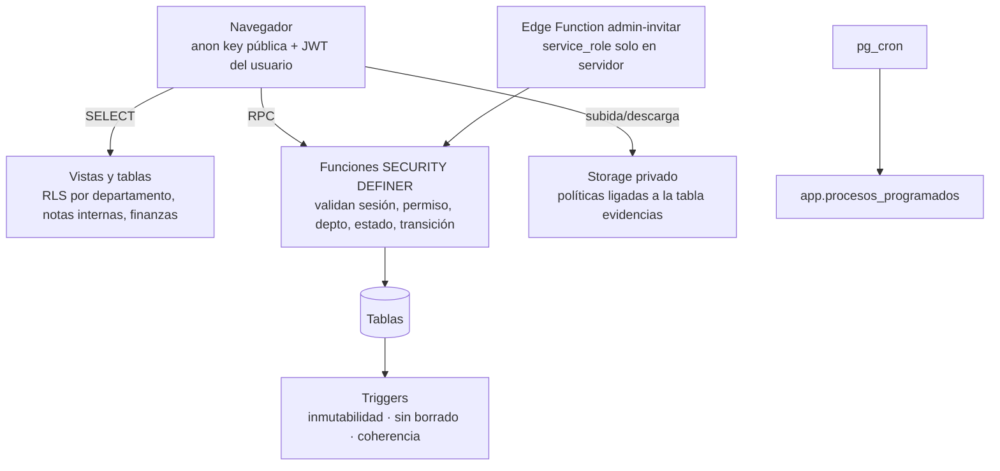

# ArreoPrime Desk | TRANSPORTES SERVICE DESK
## FASE 3 — Arquitectura, base de datos y seguridad

| Campo | Valor |
|---|---|
| Versión | 0.3.0 |
| Fecha | 2026-11-16 |
| Plataforma | Supabase (PostgreSQL 15+, Auth, Storage, pg_cron, Edge Functions) |
| Entregables | `sql/01…11`, `sql/90_datos_demo.sql`, `sql/98_pruebas_funcionales.sql`, `sql/99_pruebas_seguridad.sql`, `supabase/functions/admin-invitar/` |
| Estado de verificación | **Ejecutado en PostgreSQL 17.6 local con simulación de Supabase: todos los scripts y las 40 pruebas pasan** (ver §1) |

---

## 1. Estado de verificación — leer primero

**Qué se ejecutó (2026-11-16):** PostgreSQL 17.6 oficial para Windows en este equipo, solo en `localhost`, con `sql/local/00_simulacion_supabase.sql`. Esa simulación crea lo mínimo que Supabase trae de fábrica: roles `anon`/`authenticated`/`service_role`, `auth.users`, `auth.uid()` (idéntica a la de Supabase) y las tablas de Storage con RLS. Sobre eso corrieron **sin cambios** los scripts `01`–`10`, `90`, `98` y `99`.

| Suite | Resultado |
|---|---|
| `98_pruebas_funcionales.sql` | 21/21 correctas: horas hábiles (sábado parcial, domingo y feriado), flujo completo con espera, respuesta de un compañero, reapertura y confirmación, rechazo, cierre excepcional, anulación, prioridad, investigación con recuperación, evidencias, SLA versionado por categoría, auto-cierre y alertas sin duplicados |
| `99_pruebas_seguridad.sql` | 19/19 grupos correctos. Cada intento bloqueado imprime el motivo y se confirmó que es la regla esperada, no un error accidental |

Para repetirlo: `tools\probar-sql-local.ps1 -Psql <ruta a psql.exe> -Puerto <puerto>` (recrea la base `apd_pruebas` desde cero).

**Rendimiento medido** (2 000 tickets abiertos con hasta 60 días de antigüedad): calcular el semáforo SLA de todos toma 2,4 s; las consultas que no piden la columna `sla` tardan 7 ms. Para el volumen esperado (decenas o pocos cientos de tickets abiertos) es aceptable. Si crece, la optimización es precalcular minutos hábiles acumulados por día (§12).

**Lo que no se puede probar sin Supabase** (primer paso de la Fase 4, en un proyecto de desarrollo):
- `11_cron.sql`: pg_cron no viene en PostgreSQL para Windows. La función que programa (`app.procesos_programados`) sí se probó.
- Las columnas obligatorias reales de `auth.users` y la creación de políticas sobre `storage.objects` en el esquema real de Storage (en algunos proyectos se hace desde el panel Storage → Policies).
- La API real: PostgREST con el JWT de Supabase Auth, URLs firmadas de Storage y la Edge Function `admin-invitar`.

## 2. Cómo ejecutar

| Orden | Script | Contenido |
|---|---|---|
| 1 | `01_base.sql` | Extensiones, esquemas `app` (interno) y `reporting`, privilegios por defecto cerrados |
| 2 | `02_tablas.sql` | 49 tablas con claves, restricciones e índices |
| 3 | `03_catalogos.sql` | Departamentos, roles, 39 permisos, matriz rol-permiso, estados, transiciones, motivos, respuestas rápidas, resultados, 27 campos dinámicos, 36 categorías |
| 4 | `04_funciones_seguridad.sql` | Autorización centralizada y matriz acción × rol × estado |
| 5 | `05_motor.sql` | Horas hábiles, SLA, historial, notificaciones, auditoría, saldos financieros |
| 6 | `06_rpc.sql` | 27 funciones RPC (única vía de escritura) + proceso programado |
| 7 | `07_triggers.sql` | Inmutabilidad, sin borrado físico, coherencia de perfiles, congelamiento de SLA, alta desde Auth |
| 8 | `08_rls.sql` | RLS en todas las tablas, privilegios mínimos |
| 9 | `09_storage.sql` | Bucket privado `evidencias` y sus políticas |
| 10 | `10_vistas.sql` | `public.v_tickets` y 7 vistas `reporting` + rol `powerbi_lector` |
| 11 | `11_cron.sql` | Proceso cada 5 minutos |
| — | `90_datos_demo.sql` | **Solo desarrollo**: maestros, calendario y SLA ficticios |
| — | `98_pruebas_funcionales.sql` | **Solo desarrollo** (requiere `90`): flujos completos, termina en `ROLLBACK` |
| — | `99_pruebas_seguridad.sql` | **Solo desarrollo**: pruebas por rol, termina en `ROLLBACK` |
| — | `local/00_simulacion_supabase.sql` | **Solo PostgreSQL local**, nunca en Supabase: simula Auth y Storage |

Ejecútelos como `postgres` en el SQL Editor, en un proyecto **nuevo**, en ese orden.

## 3. Arquitectura de seguridad (defensa en capas)

| Capa | Qué garantiza |
|---|---|
| **Supabase Auth** | Identidad (JWT). Sin autorregistro: alta solo por invitación del Administrador. |
| **Perfil autorizado** | Rol y departamento se leen de `perfiles` con `auth.uid()`. El navegador nunca los envía. Los perfiles nuevos nacen **inactivos**. |
| **Privilegios** | `anon` sin acceso. `authenticated` solo tiene `SELECT` (y no sobre todas las columnas: el correo no se expone). Ninguna tabla admite `INSERT/UPDATE/DELETE` desde la API. |
| **RLS** | Activada en las 49 tablas. Visibilidad por departamento, notas internas, información financiera e investigaciones. |
| **RPC** | Toda escritura pasa por 27 funciones que validan permiso, departamento, estado y transición contra `transiciones_estado`, y escriben historial en la misma transacción. `search_path` vacío para evitar suplantación de objetos. |
| **Triggers** | Historial, auditoría, comentarios, libro financiero, hallazgos y conclusiones son de solo inserción. Tickets, perfiles e investigaciones no se borran. Número, departamento, solicitante y datos originales del ticket no cambian. Nadie cambia su propio rol, ni siquiera a través de una función. |
| **Storage** | Bucket privado. Solo se sube a una ruta reservada por el propio usuario; solo se lee si la fila de evidencia es visible por RLS; descarga por URL firmada. |
| **Errores sin fuga** | Un ticket ajeno responde «no encontrado», igual que uno inexistente. |

### 3.1 Matriz de lectura (RLS)

| Tabla / vista | Solicitante | Operador | Supervisor | Gerencia | Administrador |
|---|---|---|---|---|---|
| `tickets`, `v_tickets` | Su departamento | Todos | Todos | Todos | — |
| `comentarios` públicos | Su departamento | Todos | Todos | Todos | — |
| `comentarios` internos | **Nunca** | Todos | Todos | Todos (D-12) | — |
| `historial_tickets` | Solo eventos públicos | Públicos e internos; financieros con permiso | Todos | Todos | — |
| `evidencias` / Storage | Públicas de su depto. | Todas | Todas | Todas | — |
| `asignaciones`, `sla_excepciones` | — | Todas | Todas | Todas | — |
| `liquidacion_diferencias`, `movimientos_financieros` | Solo LIQ | Con `financiero.ver` otorgado | Todas | Todas (D-12) | — |
| `investigaciones` (estado, resultado, conclusión) | Solo LIQ (D-11) | Con `investigacion.ver` | Todas | Todas | — |
| Hallazgos, involucrados, conclusiones previas | — | Con `investigacion.ver` | Todos | Todos | — |
| `notificaciones`, preferencias | Propias | Propias | Propias | Propias | Propias |
| `auditoria` | — | — | Operativa | — | Toda |
| Catálogos, SLA, calendario | Lectura | Lectura | Lectura | Lectura | Lectura |

## 4. API

### 4.1 Lectura (consultas con RLS)

| Uso en el frontend (`APD.api`) | Fuente |
|---|---|
| `tickets.listar`, `tickets.buscar` | `v_tickets` (incluye semáforo SLA calculado y bandera de información pendiente) |
| `tickets.obtener` | `v_tickets` + `comentarios`, `evidencias`, `historial_tickets`, `asignaciones`, `liquidacion_diferencias`, `movimientos_financieros`, `investigaciones` (+ hallazgos) — cada una filtrada por RLS — y `fn_ticket_acciones` |
| `catalogos` | Tablas de catálogo y maestros |
| `dashboard`, `finanzas.resumen`, `reportes.generar` | Vistas `reporting.*` (misma RLS) |
| `notificaciones.listar` | `notificaciones` |
| `sla.estado` | `sla_versiones`, `sla_valores`, `calendario_laboral`, `feriados`, `v_tickets` |

### 4.2 Escritura (RPC)

| Función | Quién | Reglas clave |
|---|---|---|
| `fn_mi_perfil()` | Todos | Perfil y lista efectiva de permisos (para la interfaz) |
| `fn_ticket_crear(p)` | Solicitante; Transportes en registro asistido | Departamento desde el perfil; campos validados contra `categoria_campos`; consecutivo anual sin huecos; snapshot de SLA; diferencia e investigación automáticas |
| `fn_ticket_acciones(ticket)` | Todos | Acciones permitidas para ese usuario y estado |
| `fn_ticket_accion(ticket, accion, p)` | Según matriz | 16 acciones; motivos y justificaciones obligatorios; transiciones validadas |
| `fn_ticket_comentar(ticket, texto, visibilidad)` | Según permiso | Notas internas solo Transportes; sin comentarios del solicitante en tickets finalizados |
| `fn_ticket_responder_info(ticket, texto)` | Solicitante del depto. | Reanuda automáticamente el ticket (D-07) |
| `fn_evidencia_preparar` / `fn_evidencia_confirmar` | Según permiso | Flujo de 2 pasos con Storage (§5) |
| `fn_responsables_para(ticket)` | Supervisor | Elegibles, carga y sugerido |
| `fn_inv_asignar/hallazgo/aclaracion/concluir/reabrir` | Transportes autorizado | Conclusión inmutable; al reabrir se conserva la anterior |
| `fn_movimiento_registrar(...)` | `financiero.registrar` | Bloqueo de fila; sin saldo negativo; reversión única; recuperación con forma y fecha |
| `fn_sla_excepcion(ticket, métrica, justificación)` | Supervisor | Auditada |
| `fn_notificaciones_marcar_leidas`, `fn_preferencias_guardar` | Todos | Solo propias |
| `fn_exportacion_registrar` | Con permiso de reporte | Queda en auditoría |
| `fn_admin_usuarios`, `fn_admin_usuario_guardar` | Administrador | No sobre sí mismo; coherencia rol ↔ depto.; no desactiva con tickets abiertos; auditada con estado anterior |
| `fn_admin_categoria_guardar`, `fn_admin_config_guardar` | Administrador | Auditadas |
| `fn_sla_nueva_version`, `fn_calendario_guardar`, `fn_feriado_agregar/quitar` | Administrador | Las versiones no se editan: se publica una nueva |

**Errores:** cada error trae un código estable en `hint` (`NO_AUTENTICADO`, `NO_AUTORIZADO`, `NO_ENCONTRADO`, `VALIDACION`, `TRANSICION_INVALIDA`, `INMUTABLE`) y un mensaje en español listo para mostrar.

## 5. Evidencias

1. `fn_evidencia_preparar(ticket, nombre, tamaño, tipo, visibilidad)` valida permiso, ticket, tamaño (≤ 10 MB) y tipo (imágenes, PDF, Office, CSV) y reserva la ruta `{ticket_id}/{evidencia_id}`.
2. El navegador sube el archivo a esa ruta del bucket `evidencias`. La política de Storage rechaza cualquier otra ruta o usuario.
3. `fn_evidencia_confirmar(id)` verifica que el objeto exista y publica la evidencia en el historial.
4. Descarga: `createSignedUrl` con una vigencia corta (se propone 5 minutos). Storage solo la emite si la evidencia es visible para ese usuario.

Las reservas no usadas se marcan `EXPIRADA` a las 24 horas.

## 6. SLA

- **Configuración versionada:** `sla_versiones` + `sla_valores` (por prioridad y, opcionalmente, por categoría). Publicar una versión cierra la anterior; los valores publicados no se editan.
- **Snapshot por ticket:** `ticket_sla` copia los objetivos al crear el ticket. Al cambiar la prioridad se recalculan con la **misma** versión.
- **Horas hábiles:** `app.minutos_habiles` usa `calendario_laboral` y `feriados` en hora de Costa Rica. Las pausas justificadas (`sla_pausas`) se descuentan.
- **Histórico congelado:** cuando una métrica se cumple, sus minutos se guardan (`min_*`). Cambiar después el calendario o los feriados no altera tickets pasados.
- **Sin valores inventados:** los scripts productivos no cargan tiempos, calendario ni feriados. Sin versión vigente, el ticket queda «Sin SLA» (D-15).
- **Proceso cada 5 minutos:** alertas de próximo a vencer y vencido (una por métrica y nivel) y auto-cierre de resueltos (D-08).

## 7. Finanzas sin duplicación

| Tabla | Grano | Regla |
|---|---|---|
| `liquidacion_diferencias` | 1 diferencia | `monto_diferencia = esperado − recibido` (columna calculada, D-09). Inmutable. |
| `movimientos_financieros` | 1 movimiento | Identificador propio; inmutable; corrección = reversión (`revierte_id` único). |
| `recuperaciones` | 1 recuperación | Forma, comprobante y fecha de la recuperación autorizada fuera del sistema (D-19). |

Los saldos (`app.saldos_diferencia`) salen solo del libro. La vista `reporting.v_movimientos` trae `tipo_efectivo` y `monto_efectivo` para que Power BI sume sin errores de signo. Comentarios, hallazgos y actualizaciones nunca entran en estos cálculos.

## 8. Autenticación (configuración del proyecto)

1. Authentication → Providers → Email: **desactivar «Allow new users to sign up»**.
2. Plantillas de correo en español (invitación y recuperación).
3. URL del sitio y redirecciones: dominio de Vercel/Netlify.
4. D-02: si se usa Microsoft 365, configurar el proveedor Azure. **Pendiente de comprobar en la Fase 4:** que un usuario invitado pueda entrar con Microsoft y que su identidad quede enlazada por correo.
5. Recomendado: MFA obligatorio para Administrador y Supervisor.
6. Alta de usuarios: Edge Function `admin-invitar` (`supabase functions deploy admin-invitar`, con `APP_URL` y `APP_ORIGIN` definidos). La `service_role` solo existe en el servidor.
7. El acceso técnico a la consola de Supabase da control total: limitarlo a pocas personas con MFA (C-07).

## 9. Power BI

- Conectar al pooler de Supabase con el rol `powerbi_lector`. Habilitarlo manualmente: `alter role powerbi_lector with login password '…'`; la contraseña no va en el repositorio.
- El rol solo lee las vistas `reporting` y las tablas que estas necesitan. No accede a comentarios, evidencias, hallazgos ni notificaciones.
- Modelo recomendado: las vistas `reporting.*` como hechos (cada una con su grano documentado) y relaciones 1:N desde dimensiones (departamentos, categorías, prioridades, rutas, colaboradores, fecha). **Nunca** relacionar dos vistas de hechos entre sí.
- Al publicar a varias audiencias, aplicar RLS de Power BI por departamento.

## 10. Pruebas incluidas (`99_pruebas_seguridad.sql`)

| # | Verifica | Criterio de aceptación |
|---|---|---|
| 0 | Perfiles nuevos inactivos | Sin credenciales ni roles por autoservicio |
| 1–2 | Departamento fijado por el servidor; categoría ajena rechazada | No crear tickets a nombre de otro departamento |
| 3 | Sin INSERT/UPDATE/DELETE directos | El backend valida todas las operaciones |
| 4 | No se cambia el propio rol; correos ocultos | No modificar el propio rol |
| 5 | Solicitante no asigna ni crea notas internas | Permisos por rol |
| 6 | Diferencia calculada; montos fuera del ticket | Cálculos financieros |
| 7 | Comercial no ve tickets, montos ni reportes de Liquidaciones | Visibilidad por departamento, también en reportes |
| 8 | Compañero del mismo departamento ve el ticket | Visibilidad por departamento |
| 9 | No se asigna fuera de alcance | Asignaciones válidas |
| 10 | Operador sin permiso no ve montos ni gestiona tickets ajenos | El operador solo hace lo autorizado |
| 11 | Notas internas, historial interno y asignaciones ocultos | Notas internas privadas |
| 12 | Libro: sin negativos, sin doble reversión, totales estables; investigación bloquea la resolución | No duplicar montos; trazabilidad |
| 13 | Liquidaciones ve el resumen, no los hallazgos | Investigaciones con acceso controlado |
| 14 | Gerencia consulta y no modifica | Gerencia solo lectura |
| 15 | Administrador sin acceso operativo, sin cambiar su rol | Acceso administrativo limitado |
| 16–17 | Storage: sin lectura ni subida fuera de las reglas; tipos de archivo | Archivos con permisos |
| 18 | Historial inmutable; sin borrado; campos de origen protegidos | Registros críticos conservan su historial |
| 19 | Anónimo sin acceso | Sin acceso sin sesión |

## 11. Cambios respecto a las Fases 1 y 2

| Cambio | Motivo |
|---|---|
| `liquidaciones` como tabla separada se pospone; el número de liquidación vive en la diferencia | No hay sistema fuente aún (D-18); evita duplicar datos que se integrarán después |
| Perfiles nacen inactivos; el Administrador los activa | Ninguna cuenta obtiene permisos sin acción explícita y auditada |
| Evidencias en dos pasos (preparar → subir → confirmar) | Impide subir archivos a rutas o tickets no autorizados |
| SLA configurable también por categoría | Requisito del documento (§9), que el prototipo simplificaba |
| Minutos SLA congelados al cumplirse | Conservar tiempos históricos aunque cambie el calendario |
| `investigacion_conclusiones` de solo inserción | Conservar conclusiones anteriores sin editar registros |
| Permiso `sla.excepcion` (Supervisor) | Requisito «excepciones autorizadas» (§9) |
| El correo de los usuarios no es legible por la API salvo para el Administrador | Minimizar datos personales expuestos |
| Recuperaciones exigen forma y fecha | D-19: el sistema registra recuperaciones ya autorizadas |

## 12. Riesgos y pendientes

| Pendiente | Acción |
|---|---|
| Elementos propios de Supabase sin probar (§1) | Primer paso de la Fase 4: correr `01–11`, `98` y `99` en un proyecto de desarrollo |
| Semáforo SLA: 2,4 s con 2 000 tickets abiertos | La bandeja debe paginar en el servidor y pedir la columna `sla` solo para la página visible. Si el volumen crece, precalcular minutos hábiles acumulados por día (tabla de calendario) para que cada cálculo sea de tiempo constante |
| D-02, D-09, D-14, D-15 | Siguen bloqueando la puesta en producción |
| Respaldos | Plan Pro: respaldo diario; evaluar PITR. Se documenta en la Fase 6 |
| Notificaciones por correo (D-14) | Fase 4: webhook de base de datos sobre `notificaciones` → Edge Function de envío |
